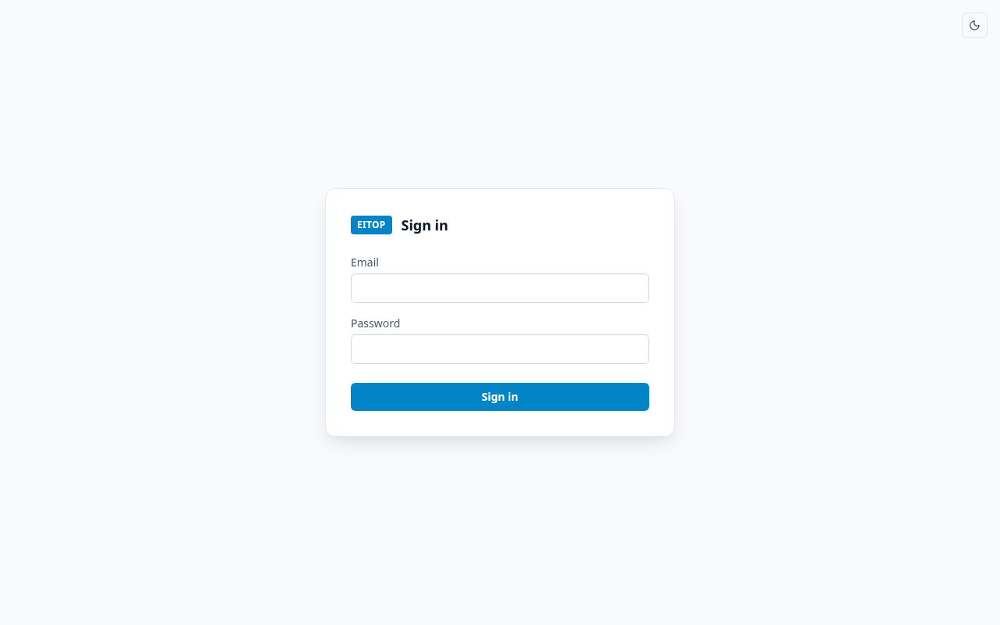
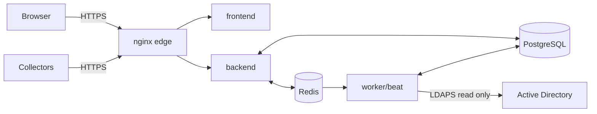

# EITOP — Enterprise IT Operations Platform

EITOP is an open-source, modular enterprise IT operations platform for endpoint
inventory, security compliance, vulnerability management, network operations,
and IT automation.

> **Status:** Phases 1–5 complete — foundation, endpoint operations,
> read-only Active Directory module (sync, inventory, security findings,
> insights), production deployment/hardening, and full documentation.
> Administration UI remains marked "Soon" in the UI (the administration
> **API** is live). See [docs/architecture/README.md](docs/architecture/README.md)
> for the system overview.


## Features

### Platform core

- FastAPI backend with versioned REST API (`/api/v1`)
- Argon2id password hashing, JWT access tokens, rotating refresh tokens
  with reuse detection; refresh token in an **HttpOnly cookie** (never in
  JSON bodies or localStorage) with CSRF Origin checks
- Role-based access control (admin, security_auditor, operator, readonly, agent)
- Audit logging of authentication and privileged actions — append-only at
  the application *and* database level (PostgreSQL trigger)
- Structured JSON logging, RFC 9457 problem responses, health/readiness probes
- Security headers (nosniff, frame deny, referrer policy, CSP on the SPA)
- Redis-backed rate limiting on auth endpoints (fails closed; proxy
  overwrites `X-Forwarded-For` so the key cannot be spoofed)

### Endpoint operations

- Linux agent and Windows collector: inventory, heartbeat, enrollment,
  secure communication with the platform
- Endpoint inventory with detail views, history, OS/process/agent data
- Endpoint groups and a management dashboard with monitoring views
- React + TypeScript + Vite + Tailwind CSS + TanStack Query frontend with
  an enterprise design system (light/dark themes)

### Active Directory — read-only

- LDAP/LDAPS connections (secrets Fernet-encrypted, never exposed by the API)
- Synchronization engine with lifecycle hardening: category tracking,
  freshness/overdue evaluation, never writing back to the directory
- Directory objects: users, groups, computers, OUs, memberships
- Security findings engine (privileged membership, stale/disabled subjects,
  sync freshness) with severity, acknowledge/suppress/reopen lifecycle
- Insights UI: findings table with server-side sort/filter/pagination,
  summary metrics, detail drawer with structured evidence
- Health tab: newest-run verdict, category completeness, visibility, freshness
- Correlation Gaps tab: never_reconciled / unmatched / ambiguous only,
  with unconfirmed candidates clearly labelled

### Production & operations

- Docker Compose dev stack + production overlay: TLS edge proxy,
  HTTP→HTTPS/HSTS, unpublished data services, resource limits, log
  rotation, worker healthchecks, fail-fast production config validation
- Encrypted, checksummed PostgreSQL backups with retention and a
  verified restore procedure
- 16 operational runbooks (deployment, enrollment, AD, backups,
  upgrades, secret rotation, incident response, …)



## Architecture (summary)

Modular monolith in Docker Compose: React SPA behind an nginx TLS proxy,
FastAPI API + Celery worker/beat sharing one codebase, PostgreSQL as
system of record, Redis as broker/rate-limiter, and push-based
collectors. No Kubernetes, no microservices, no external SaaS.



Details: [docs/architecture/README.md](docs/architecture/README.md) ·
[data flows](docs/architecture/data-flow.md) ·
[security model](docs/architecture/security.md).

## Prerequisites

- Docker + Docker Compose ≥ 2.24 (production overlay uses `!override`)
- For host-based development only: Python 3.12, Node 20+, PostgreSQL, Redis

## Quick start (Docker)

```bash
cp .env.example .env          # then set SECRET_KEY!
docker compose up --build
```

- Frontend: http://localhost:8080
- Backend API + OpenAPI docs: http://localhost:8000/docs
- First admin: see
  [docs/runbooks/administrator-bootstrap.md](docs/runbooks/administrator-bootstrap.md)

Full install guide: [docs/installation/README.md](docs/installation/README.md).

## Quick start (local development)

Requires Python 3.12, Node 20+, PostgreSQL, Redis. See
[docs/local-development.md](docs/local-development.md).

```bash
# Backend
cd backend
python3.12 -m venv .venv && source .venv/bin/activate
pip install -r requirements-dev.txt
alembic upgrade head
python -m app.db.seed          # seed roles + permissions
uvicorn app.main:app --reload

# Frontend
cd frontend
npm install
npm run dev                    # http://localhost:5173 (proxies /api to :8000)
```

## Production

```bash
cp .env.example .env && chmod 600 .env   # APP_ENV=production, strong secrets
docker compose -f docker-compose.yml -f docker-compose.prod.yml up -d --build
```

Step-by-step: [docs/installation/production.md](docs/installation/production.md).

## Tests

```bash
cd backend && pytest           # needs Postgres + Redis, see docs/testing.md
cd frontend && npm test
cd collectors/linux && .venv/bin/pytest
cd collectors/windows && Invoke-Pester -Path ./tests
```

Full gates and CI: [docs/testing.md](docs/testing.md).

## Documentation

| Area | Document |
|---|---|
| Architecture & data flows | [docs/architecture/](docs/architecture/) ([overview](docs/architecture/README.md) · [data-flow](docs/architecture/data-flow.md) · [security](docs/architecture/security.md)) |
| Installation | [docs/installation/README.md](docs/installation/README.md) (dev) · [production.md](docs/installation/production.md) |
| Configuration reference | [docs/configuration/README.md](docs/configuration/README.md) |
| API & permissions | [docs/api/README.md](docs/api/README.md) |
| Runbooks (operations) | [docs/runbooks/README.md](docs/runbooks/README.md) |
| Collectors | [docs/collectors/README.md](docs/collectors/README.md) |
| Active Directory | [docs/active-directory/README.md](docs/active-directory/README.md) |
| Deployment & backups | [docs/deployment/](docs/deployment/) ([runbook](docs/deployment/README.md) · [backup-restore](docs/deployment/backup-restore.md)) |
| Troubleshooting | [docs/troubleshooting/README.md](docs/troubleshooting/README.md) |
| Local development | [docs/local-development.md](docs/local-development.md) |
| Authentication flow | [docs/authentication.md](docs/authentication.md) |
| RBAC model | [docs/rbac.md](docs/rbac.md) |
| Database migrations | [docs/database-migrations.md](docs/database-migrations.md) |
| Running tests | [docs/testing.md](docs/testing.md) |
| Endpoint & agent docs | [docs/endpoints/](docs/endpoints/) |
| Frontend design system | [docs/frontend/design-system.md](docs/frontend/design-system.md) |
| Phase 1 security review | [docs/security/PHASE1_SECURITY_REVIEW.md](docs/security/PHASE1_SECURITY_REVIEW.md) |
| UI screenshots | [docs/screenshots/](docs/screenshots/) |

## Security

Report vulnerabilities per [SECURITY.md](SECURITY.md). Never commit secrets;
all configuration is via environment variables (see `.env.example`).
Limitations and verified/unverified status:
[docs/architecture/security.md](docs/architecture/security.md#explicit-limitations).

## License

MIT — see [LICENSE](LICENSE).
