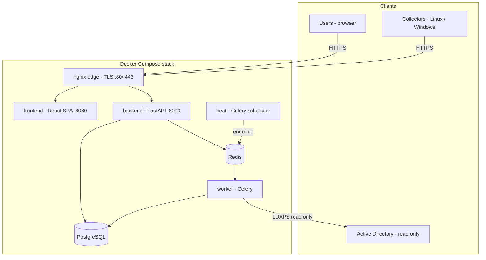

# System architecture

EITOP is a **modular monolith** in Docker Compose: one FastAPI backend
(with Celery workers sharing the codebase), one React frontend, a
PostgreSQL system of record, Redis as broker/rate-limiter, and
out-of-band collectors that push data inward. No Kubernetes, no
microservices, no external SaaS dependencies.

## Components

| Component | Compose service | Responsibility |
|---|---|---|
| Edge proxy | `proxy` (prod overlay) | TLS termination, HTTP→HTTPS, HSTS, trusted `X-Forwarded-For` overwrite |
| Frontend | `frontend` | React SPA; in dev also proxies `/api` to the backend |
| API | `backend` | REST API, auth/RBAC, audit, directory endpoints; entrypoint runs `alembic upgrade head` + RBAC/admin seed on start |
| Worker | `worker` | Celery consumer: offline scan, snapshot pruning, AD sync, insights/findings |
| Scheduler | `beat` | Celery beat — sole enqueuer of periodic jobs (never scaled) |
| Database | `postgres` | all durable state; volumes `pgdata` |
| Broker | `redis` | Celery broker + rate-limit counters; AOF persistence; no eviction policies |
| Collectors | (external hosts) | push heartbeat + inventory with per-endpoint credentials |

## Layering (backend)

| Layer | Location | Role |
|---|---|---|
| API | `backend/app/api/v1/` | routers, request validation, permission dependencies |
| Services | `backend/app/services/` | business logic (auth, endpoints, `directory/`) |
| Models | `backend/app/models/` | SQLAlchemy ORM |
| Core | `backend/app/core/` | settings, security, logging, rate limit, exceptions, celery |
| Tasks | `backend/app/tasks/` | Celery task definitions + beat schedule |
| Migrations | `backend/alembic/versions/` | forward-only schema evolution |

Frontend: `frontend/src/` (React + TypeScript + Vite), design system
in `docs/frontend/design-system.md`.

## Key design decisions (ADR-style)

1. **Stateless JWT access tokens + rotating opaque refresh cookie.**
   No server-side sessions; revocation = refresh-family kill +
   short access TTL. Rationale: horizontal API scaling; theft
   detectable via rotation/reuse detection.
2. **Fail-closed rate limiting.** Redis down ⇒ login/refresh/enroll
   return 503 rather than running unprotected. Availability traded for
   brute-force safety.
3. **Append-only audit log.** No update/delete API; forensic integrity
   over storage economy.
4. **Single trusted proxy hop with XFF overwrite.** Rate limiting keys
   on client IP; appending proxies would make it spoofable — the edge
   *overwrites* `X-Forwarded-For`, backend binds loopback in dev.
5. **Sync ownership by database lease.** Directory syncs are
   single-flight per connection; leases expire
   (`DIRECTORY_STALE_RUN_MINUTES`) so a dead worker cannot wedge a
   connection; `DIRECTORY_MAX_SYNC_MINUTES` caps any run.
6. **Push-based collector model.** Collectors enroll once, then push
   heartbeat/inventory over HTTPS — no inbound ports on endpoints.
7. **Idempotent inventory ingestion.** Current-state upsert +
   content-hash-deduplicated immutable snapshots: retries and restarts
   never corrupt history.

## Data model overview

Core tables (migrations `0001`–`0007`):

| Group | Tables |
|---|---|
| Identity | `users`, `roles`, `permissions`, `role_permissions`, `user_roles` |
| Sessions | `refresh_tokens` (hashed, family-scoped) |
| Audit | `audit_logs` (append-only) |
| Endpoints | `endpoints`, `enrollment_tokens`, `endpoint_credentials`, `endpoint_groups`, inventory tables (`endpoint_metadata`, `endpoint_facts`, `endpoint_software`), snapshots (`endpoint_snapshots`, `endpoint_snapshot_software`) |
| Directory | `directory_connections`, domains/OUs/users/groups/computers, `directory_sync_runs`, `directory_reconciliations`, `directory_findings` |

Schema evolution: [../database-migrations.md](../database-migrations.md).

## Environments

| | Development | Production |
|---|---|---|
| Compose | `docker compose up --build` | `+ -f docker-compose.prod.yml` |
| Ports | backend loopback `:8000`, frontend `:8080` | only `:80`/`:443` (proxy) |
| `APP_ENV` | `development` | `production` (fail-fast validation) |
| Cookies | non-`Secure` | `Secure` |
| `/docs` | enabled | disabled |

## Further reading

- [Data flows](data-flow.md) · [Security model](security.md)
- [Deployment](../deployment/README.md) · [Configuration](../configuration/README.md)
- [API reference](../api/README.md)
