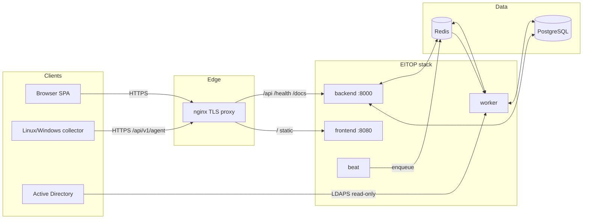
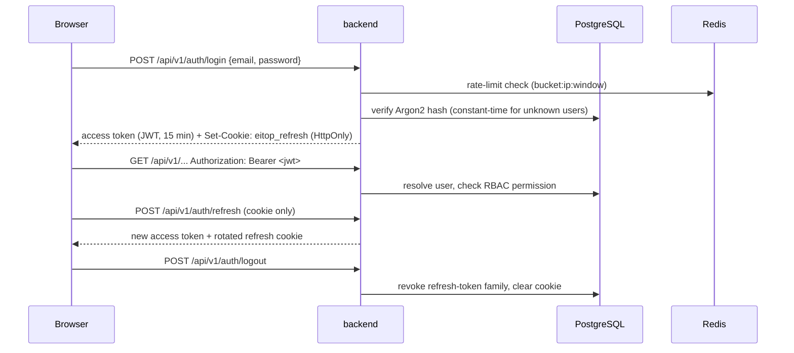
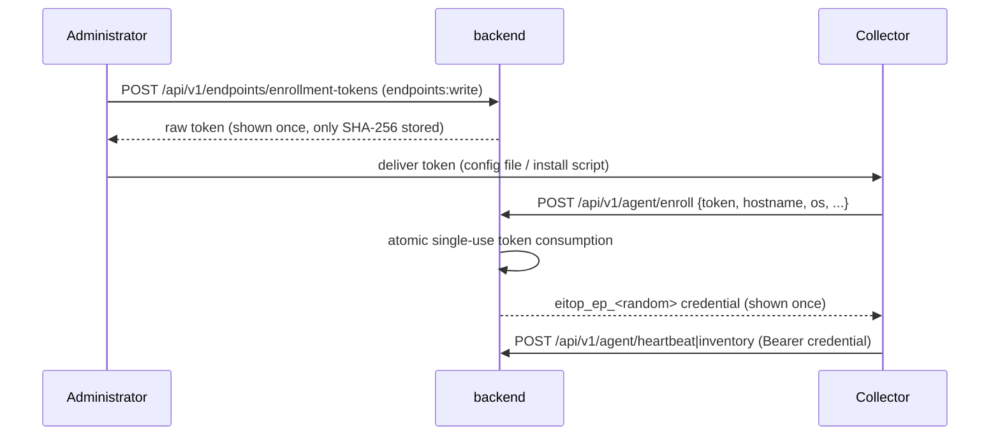
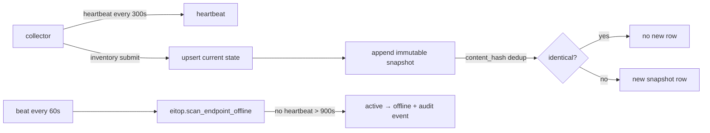
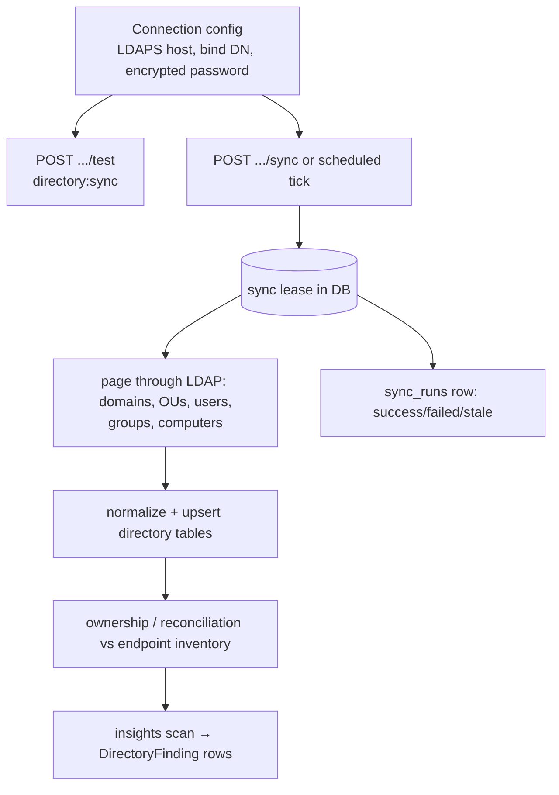
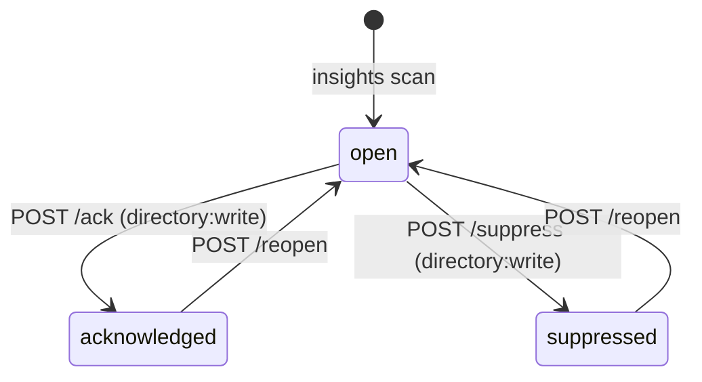

# Data flows

How data moves through EITOP, from login to findings. Companion documents:
[architecture overview](README.md), [security model](security.md).

## Overview

| Component | Responsibility |
|---|---|
| nginx edge (`infrastructure/nginx/eitop.conf`) | TLS termination, HTTP→HTTPS, HSTS, overwrites `X-Forwarded-For` |
| frontend | React SPA + dev-mode API proxy (production serves static only) |
| backend | REST API, auth, RBAC, audit, directory proxy endpoints |
| worker | Celery: offline scan, snapshot pruning, directory sync, insights |
| beat | Celery scheduler — the only process that enqueues periodic jobs |
| PostgreSQL | system of record (all durable state) |
| Redis | Celery broker, rate-limit counters (no durable state) |

## Authentication

Details:

- Access tokens are short-lived JWTs signed with `SECRET_KEY`
  (`ACCESS_TOKEN_EXPIRE_MINUTES`, default 15).
- The refresh token is opaque, stored hashed, lives in an `HttpOnly`
  cookie scoped to `Path=/api/v1/auth` with `SameSite=Lax`
  (`Secure` in production). Every refresh **rotates** it.
- Reusing a rotated refresh token is detected (`auth.refresh.reuse` in
  the audit log): the whole token family is revoked — the legitimate
  client must log in again. This is what makes theft detectable.
- Unknown e-mails still burn a password verification (timing
  equalization) and rate limiting is **fail-closed**: Redis down ⇒
  login/refresh return 503 rather than unprotected.

## Endpoint enrollment

- Tokens are single-use and expire; failures return one uniform error
  ("invalid, expired, or already used") — no oracle for guessing.
- The agent credential is bound to exactly one endpoint row; nothing in
  a request can retarget it. A user JWT is rejected on agent routes and
  an agent credential is rejected on user routes.
- Rotation: `POST /api/v1/endpoints/{id}/rotate-credential` (admin) or
  the agent's own `POST /api/v1/agent/rotate-credential`. Revocation:
  `POST /api/v1/endpoints/{id}/revoke`.

## Inventory collection

- `POST /api/v1/agent/inventory` upserts the endpoint's *current*
  normalized state (software, network, users, packages) **and** appends
  an immutable snapshot row. Re-submitting byte-identical inventory
  creates no duplicate snapshot (`ON CONFLICT (endpoint_id, content_hash)`).
- `eitop.scan_endpoint_offline` (beat, every `ENDPOINT_HEALTH_SCAN_SECONDS`)
  is the **only** writer of the active→offline transition; recovery to
  active happens synchronously when the agent submits again.
- Snapshot history is pruned by `eitop.prune_endpoint_snapshots` when
  `SNAPSHOT_RETENTION_DAYS` is set (default: keep forever).

## Active Directory synchronization

- Connections are read-only by design: **EITOP never writes to
  Active Directory.** Bind credentials are Fernet-encrypted with a key
  derived from `SECRET_KEY` (see [security.md](security.md)).
- Exactly one sync per connection runs at a time (DB lease). Stale
  leases are reaped after `DIRECTORY_STALE_RUN_MINUTES`, absolute cap
  `DIRECTORY_MAX_SYNC_MINUTES`.
- `eitop.directory_sync_tick` (beat) enqueues scheduled syncs;
  `eitop.directory_insights_tick` (beat) regenerates insights/findings.
- Inventory gaps (endpoint never scanned a category) surface as
  "insufficient visibility" findings after `DIRECTORY_MISSING_GRACE_DAYS`.

## Findings lifecycle

- Findings are **generated** by the insights scan (system actor) and
  **lifecycle-managed** by humans: acknowledge, suppress, reopen.
  Every transition is written to the audit log.
- Read access (`GET /directory/findings*`) needs `directory:read`;
  transitions need `directory:write`.

## Audit flows

- Every security-relevant event appends to the `audit_logs` table
  (append-only; no update/delete API exists).
- Event families: `auth.login.success|failure`,
  `auth.refresh.success|failure|reuse`, `endpoint.enrollment_token.created`,
  endpoint revoke/rotate, directory connection changes, sync runs,
  findings transitions, admin user management.
- Events carry actor id, target, outcome, timestamp, request id — never
  secrets, passwords, tokens, or raw LDAP errors.
- Read via `GET /api/v1/audit-logs` (`audit:read`).

## Related

- API reference: [../api/README.md](../api/README.md)
- Runbooks: [../runbooks/README.md](../runbooks/README.md)
- Troubleshooting: [../troubleshooting/README.md](../troubleshooting/README.md)
