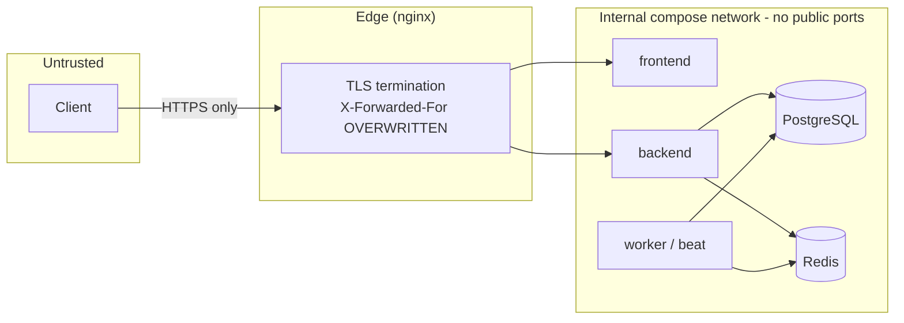

# Security model

What protects EITOP, where the trust boundaries sit, and what is
deliberately out of scope. Companion documents:
[architecture overview](README.md), [data flows](data-flow.md),
[../security/README.md](../security/README.md).

## Trust boundaries

Rules that hold in production (`docker-compose.prod.yml`):

- Only ports 80/443 are published. Backend, frontend, PostgreSQL and
  Redis have **no host ports**; they are reachable only on the internal
  `eitop` network.
- There is exactly **one** trusted proxy hop. It *overwrites*
  `X-Forwarded-For` with the real client address (never appends) and
  sends `X-Forwarded-Proto: https`. The backend binds loopback in dev
  so nothing can bypass it. Do not add another appending proxy in front
  — the rate limiter keys on that header and would become spoofable.
- The backend runs non-root, read-only root filesystem, `tmpfs /tmp`,
  `no-new-privileges`.

## Authentication

| Property | Value |
|---|---|
| Access token | JWT HS256, signed with `SECRET_KEY`, `sub` = user id, TTL `ACCESS_TOKEN_EXPIRE_MINUTES` (≤ 60, default 15) |
| Refresh token | opaque, random, stored **hashed**, TTL `REFRESH_TOKEN_EXPIRE_DAYS` (≤ 90, default 7) |
| Refresh transport | `eitop_refresh` cookie: `HttpOnly`, `SameSite=Lax`, `Path=/api/v1/auth`, `Secure` **iff** `APP_ENV=production` |
| Rotation | every `/auth/refresh` issues a new refresh token and invalidates the previous one |
| Reuse detection | presenting an already-rotated token ⇒ `auth.refresh.reuse` audit event + **entire family revoked** |
| Logout | revokes the family and clears the cookie (`204`) |
| Passwords | Argon2; unknown e-mails still perform a dummy verification (timing equalization) |
| Brute force | per-minute limits on login/refresh/enroll, keyed `bucket:ip:window`; **fail-closed** — Redis unavailable ⇒ 503, never open access |

Agent identity is a **separate credential space**: collector secrets are
`eitop_ep_`-prefixed and bound to one endpoint row. User JWTs are
rejected on `/agent/*`; agent credentials are rejected on user routes.
Authorization is fixed at credential issuance — request content cannot
retarget it.

## Authorization (RBAC)

- Permission checks happen in route dependencies
  (`require_permissions("scope:action")`); the permission catalog and
  five seeded roles live in `backend/app/db/seed.py`.
- Roles: `admin`, `security_auditor`, `operator`, `readonly`, `agent`.
  Full matrix: [../rbac.md](../rbac.md) and
  [../api/README.md](../api/README.md#permission-matrix).
- Permission sets are additive on re-seed (new catalog entries are
  granted to existing roles); nothing is ever silently revoked.
- Superpowers are explicit: `admin:write` manages users; `directory:sync`
  tests/trigger syncs; `endpoints:write` manages enrollment and revokes.

## CSRF and browser defenses

- **Origin check middleware**: any state-changing method (`POST`,
  `PUT`, `PATCH`, `DELETE`) under `/api/v1` carrying an `Origin` header
  outside `CORS_ORIGINS` is rejected `403` (`application/problem+json`).
  Safe methods (`GET`/`HEAD`/`OPTIONS`) are exempt; non-browser clients
  send no `Origin` and are unaffected.
- **`Sec-Fetch-Site` fallback**: when a request has *no* `Origin` header
  but declares `Sec-Fetch-Site: cross-site` (older browser/proxy chains
  that strip `Origin`), it is rejected `403` as well. Browsers always
  send `Sec-Fetch-Site` on cross-site requests; non-browser clients send
  neither header and are unaffected.
- `SameSite=Lax` on the refresh cookie means cross-site POSTs never
  carry it — the Origin check is defense in depth, not the only layer.
- CORS allowlist is comma-separated `https://` origins only in
  production (startup validation rejects `*` and plain `http://`).
- Security headers on every API response: `X-Content-Type-Options:
  nosniff`, `X-Frame-Options: DENY`, `Referrer-Policy:
  strict-origin-when-cross-origin`; the SPA adds CSP at the edge, and
  HSTS is added by the TLS proxy **and** (production) by the backend as
  defense-in-depth if the edge is ever bypassed — the duplicate header is
  intentional (F16).

## Request hardening

- Body-size limits enforced from `Content-Length` **before parsing**
  (413): inventory 5 MB, enroll 16 KB, other agent routes 8 KB,
  endpoint routes 256 KB, everything else 64 KB.
- Requests with `Transfer-Encoding: chunked` on state-changing API
  methods are rejected `411 Length Required` — chunked bodies bypass
  `Content-Length` pre-checks, and none of our clients (frontend fetch,
  collectors, agents) ever chunk. Empty POSTs without either header are
  legal and unaffected.
- Login/refresh/enroll are rate-limited; limit values are settings
  (`RATE_LIMIT_*`), not hardcoded. Login is limited **per IP and per
  account** (account key = SHA-256 of the lowercased email — the raw
  email never enters Redis), so distributed brute force against one
  account is capped independently of source IPs.
- Every API response carries an `X-Request-ID` header. The value is
  always **synthesized server-side** (never trusted from the client) and
  is attached to every JSON log record via a context variable — request
  correlation in logs and responses is real, not aspirational.
- Enrollment-token failures return one uniform error — no existence
  oracle.

## Encryption at rest / in transit

| Data | Protection |
|---|---|
| In transit (browser, collector) | TLS 1.2/1.3 at the edge proxy (modern ECDHE cipher suite, HSTS) |
| AD bind passwords (DB column) | Fernet (AES-128-CBC + HMAC), key = HKDF-SHA256(`SECRET_KEY`, info `eitop-directory-credential-v1`); decrypted only inside the LDAP client at bind time; never returned by any API, never logged, never audited |
| Backups | AES-256-CBC + PBKDF2 (100k iterations), key from `BACKUP_ENCRYPTION_KEY` env (never argv); sha256 sidecar per dump |
| Secrets at rest | `.env` (0600, gitignored), `certs/` gitignored; no real secrets tracked in git |
| Passwords / tokens in logs | never — the JSON formatter attaches a fixed field set |

## Audit logging

- Append-only `audit_logs` table; **no API exists to modify or delete
  entries** (read-only via `GET /api/v1/audit-logs`, `audit:read`).
- Recorded events: login success/failure, refresh success/failure/
  reuse, enrollment-token creation, credential rotate/revoke, directory
  connection CRUD, sync runs, findings ack/suppress/reopen, user
  management.
- Event payloads carry ids, outcomes, and request correlation — never
  credentials or raw third-party error text.

## Startup safety (fail-fast)

With `APP_ENV=production` every process (API, worker, beat, migrations)
refuses to boot unless: `DEBUG=false`; `SECRET_KEY` ≥ 32 chars and not a
placeholder; DB credentials are not the dev defaults; Redis URL carries
a real password; `CORS_ORIGINS` is https-only with no wildcard. All
violations are reported in one aggregated error.

## Explicit limitations

These are documented product boundaries, not bugs:

| Limitation | Consequence |
|---|---|
| **Single-tenant deployment model** | There is no tenant/org column on any resource and RBAC is global: any `directory:read` holder sees every connection, any authenticated user sees the endpoints their role allows. Cross-object access control is by permission + UUID unguessability, **not** by tenant isolation. Deploying multiple unrelated organizations into one instance is unsupported — run one instance per organization. |
| **Stateless access tokens** | Access JWTs are valid until `exp` (15 min) even after logout or credential change — there is no denylist. Revocation authority is the refresh-token family: refresh-after-logout is `401` immediately; the worst case for a stolen *access* token is the remaining token lifetime. |
| Cookie `Secure` attribute in dev | Set only under `APP_ENV=production`; dev/demo run over plain HTTP on localhost by design (A11 accepted). |
| Access JWT carries the email | The email claim is readable by anyone holding the token (the holder is the legitimate user; JWTs are not encrypted). Accepted tradeoff for claims-based authz without a per-request DB read (A12 accepted). |
| Post-logout refresh replay can audit a false theft alarm | Replaying an already-revoked refresh token after logout hits the `auth.refresh.reuse` theft-detection path even though no attacker is present (the family was revoked by logout). Event name is not distinguished (A14 accepted — would require a schema migration for marginal value); the security outcome is identical (401, family dead). |
| LDAP target configuration implies an SSRF surface | `directory:write` (an admin-equivalent role) can point connection probes/binds at arbitrary `host:port` — an inherent property of "configure an LDAP server", not a defect. Mitigated by role gating; no unauthenticated or low-privilege path exists (AD-6 accepted). |
| `search_base` DN syntax validated only at runtime | A malformed DN fails during sync with a classified error label instead of at create/update time. Not an injection risk: the DN is never interpolated into a filter (constant `(objectClass=*)`), and `bind_username` is sent as the bind name only (AD-7 accepted). |
| No AD write operations | EITOP is read-only against Active Directory — remediation is manual |
| Microsoft AD real-environment validation outstanding | LDAP behavior verified against test doubles; a real Microsoft AD trial is still pending (see Phase reports) |
| Windows native execution validation outstanding | Windows collector passes its Pester suite in containers; native-domain execution untested |
| Browser-based E2E testing outstanding | UI verified by component tests + screenshot scripts, not end-to-end browser automation |
| No PITR / WAL archiving | RPO = backup interval (see [../deployment/backup-restore.md](../deployment/backup-restore.md)) |
| Backup key loss = backup loss | encryption key is stored separately from `.env` by design; there is no recovery |
| `SECRET_KEY` rotation | invalidates all JWTs (users re-login) **and** makes stored AD bind passwords undecryptable — re-enter them via `PATCH /directory/connections/{id}` after rotation |
| Redis data loss | queued Celery tasks are lost (idempotent re-run; beat re-schedules) and rate-limit counters reset (brute-force window re-arms) |
| TLS certificates | production requires a real certificate chain for the serving domain; the repo ships no certificates |
| Trusted-header assumption | rate limiting and audit IPs trust the single edge proxy's `X-Forwarded-For` **rightmost hop** (the hop added by the nearest proxy); direct backend access is not published in production |
| Dependency hash-pinning deferred | CI runs `pip-audit` (prod + dev requirements) and `npm audit --audit-level=high` as failing gates, but `requirements.txt` still uses range pins without `--hash` values. Hash-pinning was deferred to avoid a blind re-pin of the dependency tree; residual risk = a compromised package index serving a different artifact within the pinned range between audit and build (F5 residual accepted). |

## Verified vs unverified

**Verified** (automated suites + live audits in Phases 3–4): auth
lifecycle incl. rotation/reuse/family-kill, RBAC matrix across all five
roles, CSRF origin enforcement, rate limiting incl. fail-closed
behavior, security headers, cookie attributes, HTTPS redirect/TLS/HSTS,
backup→restore round-trip, restart persistence, fail-fast production
validation.

**Not verified**: real Microsoft AD, native Windows execution,
browser E2E, PITR recovery, certificate rotation automation.
